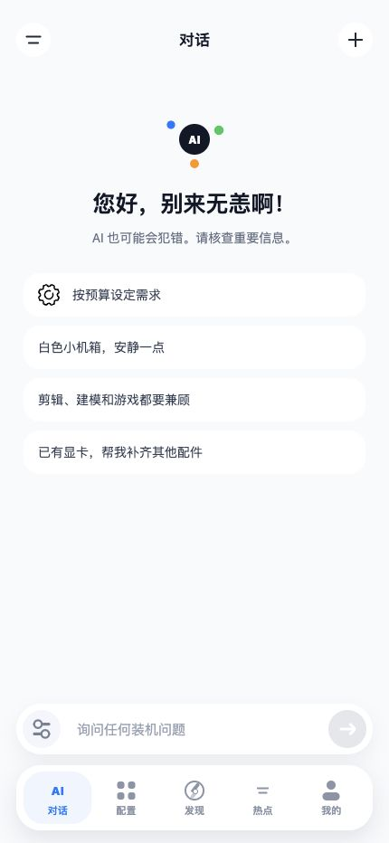
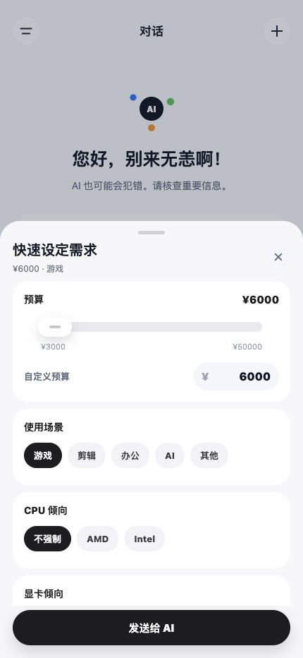
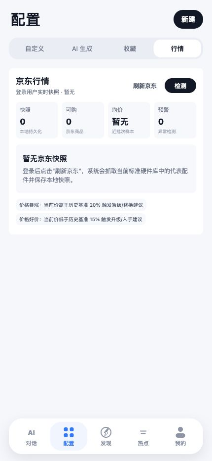
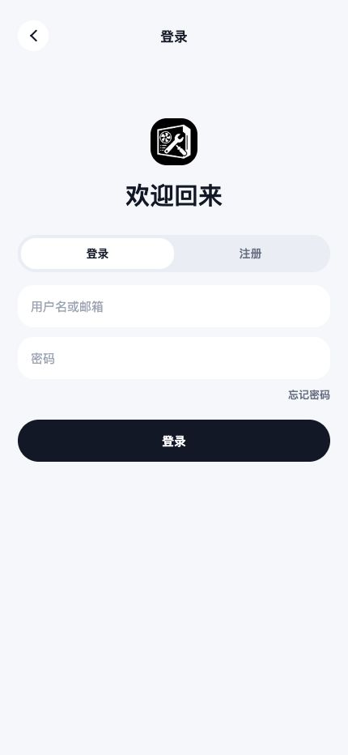

# Smart DIY PC Assistant

<p align="center">
  <a href="../README.md">🇨🇳 简体中文</a> ·
  🇭🇰 繁體中文 ·
  <a href="README.en-US.md">🇺🇸 English</a>
</p>

面向 DIY PC 裝機場景的智慧化助手，透過錄入標準硬體型號庫，自動取得京東商品作為即時價格、圖片和購買連結來源。
專案包含使用者端、管理端和 Spring Boot 後端，涵蓋 AI 裝機對話、配置單生成、京東商品搜尋、硬體相容性檢查、社群動態、熱點新聞、個人空間、使用者管理和帳號安全等功能。

## 目錄

- [展示截圖](#展示截圖)
- [核心功能](#核心功能)
- [技術棧](#技術棧)
- [專案結構](#專案結構)
- [環境需求](#環境需求)
- [快速開始](#快速開始)
- [設定說明](#設定說明)
- [開發檢查](#開發檢查)
- [安全說明](#安全說明)
- [貢獻](#貢獻)
- [授權](#授權)

## 展示截圖

<p align="center">
  <span>
    
  </span>
  <span>
    
  </span>
  <span>
    
  </span>
  <span>
    
  </span>
  <br />
  <sub>AI 裝機對話</sub>
  &nbsp;&nbsp;&nbsp;&nbsp;&nbsp;&nbsp;
  <sub>快速需求設定</sub>
  &nbsp;&nbsp;&nbsp;&nbsp;&nbsp;&nbsp;
  <sub>京東硬體行情</sub>
  &nbsp;&nbsp;&nbsp;&nbsp;&nbsp;&nbsp;
  <sub>帳號登入</sub>
</p>

## 核心功能

- AI 裝機對話：根據預算、用途、外觀偏好與效能需求生成配置單。
- 標準硬體型號庫：資料庫只存 CPU、主機板、顯示卡、記憶體、硬碟、電源、機殼、散熱器等標準型號。
- 京東商品搜尋：後端使用 Spring Boot + Jsoup 抓取京東搜尋結果，回傳標題、價格、圖片、連結與 SKU。
- 配置單系統：支援手動建立、AI 生成、收藏、預覽、詳情查看與京東商品跳轉。
- 相容性檢查：檢查 CPU 插槽、主機板記憶體類型、電源功率、機殼版型與散熱等級等基礎規則。
- 社群動態：支援發布動態、上傳圖片、關聯配置單、按讚、收藏與留言。
- 個人空間：展示使用者資料、背景圖、動態、收藏內容、關注與粉絲資料。
- 熱點新聞：支援新聞列表、排序、詳情、按讚、收藏與留言。
- 帳號安全：支援信箱驗證碼、圖形驗證碼、密碼強度校驗、JWT 鑑權、密碼雜湊儲存與帳號封禁。
- 管理後台：管理使用者、標準硬體型號、新聞熱點、社群內容、AI 設定與系統設定。

## 技術棧

| 模組 | 技術 |
| --- | --- |
| 後端 | Java 17, Spring Boot 3.5, Spring Security, Spring Data JPA, MySQL, Redis |
| AI | LangChain4j OpenAI adapter |
| 商品抓取 | Jsoup |
| 使用者端 | uni-app, Vue |
| 管理端 | Vue 3, TypeScript, Vite |
| 物件儲存 | 七牛雲物件儲存 |
| 郵件服務 | SMTP |
| 鑑權 | JWT |

## 專案結構

```text
smart-diy-pc-assistant/
├── smart-diy-pc-assistant-backend/   # Spring Boot 後端
├── smart-diy-pc-assistant-admin/     # Vue 管理端
├── smart-diy-pc-assistant-uniapp/    # uni-app 使用者端
├── i18n/                             # 多語言 README
├── LICENSE
└── README.md
```

## 環境需求

- JDK 17+
- Maven 3.9+，或使用後端模組內建 Maven Wrapper
- MySQL 8+
- Redis 6+
- Node.js 20+，用於管理端
- HBuilderX，用於執行 uni-app 使用者端
- 可選：七牛雲物件儲存、SMTP 信箱、OpenAI 相容模型服務

## 快速開始

### 1. 建立資料庫

```sql
CREATE DATABASE smart_diy_pc_assistant
  DEFAULT CHARACTER SET utf8mb4
  COLLATE utf8mb4_unicode_ci;
```

### 2. 設定後端私有參數

在 `smart-diy-pc-assistant-backend/src/main/resources/application-local.yaml` 中放置本機私有設定：

```yaml
spring:
  datasource:
    url: jdbc:mysql://localhost:3306/smart_diy_pc_assistant?useUnicode=true&characterEncoding=utf8&serverTimezone=Asia/Shanghai&allowPublicKeyRetrieval=true&useSSL=false
    username: your_mysql_user
    password: your_mysql_password
  data:
    redis:
      host: localhost
      port: 6379
  mail:
    username: your_mail_account
    password: your_mail_authorization_code

app:
  security:
    jwt-secret: replace-with-a-long-random-secret
  qiniu:
    access-key: your_qiniu_access_key
    secret-key: your_qiniu_secret_key
    bucket: your_bucket
    domain: https://your-cdn-domain
  ai:
    base-url: https://your-openai-compatible-endpoint
    api-key: your_api_key
    model-name: your_model
```

### 3. 啟動後端

```bash
cd smart-diy-pc-assistant-backend
./mvnw spring-boot:run
```

Windows：

```powershell
cd smart-diy-pc-assistant-backend
.\mvnw.cmd spring-boot:run
```

預設後端位址：`http://localhost:8080`

### 4. 啟動管理端

```bash
cd smart-diy-pc-assistant-admin
npm install
npm run dev
```

預設 Vite 位址通常為 `http://localhost:5173` 或 `http://localhost:5174`。

### 5. 啟動使用者端

1. 使用 HBuilderX 開啟 `smart-diy-pc-assistant-uniapp`。
2. 確認 `smart-diy-pc-assistant-uniapp/common/api.ts` 中的 `API_BASE_URL` 指向後端位址。
3. 使用 HBuilderX 執行到 Web 瀏覽器、App 或小程式目標平台。

## 設定說明

- `application.yaml` 只保留預設開發設定。
- `application-local.yaml` 用於本機私有設定，不應提交到倉庫。
- 生產環境建議使用環境變數或獨立的伺服器設定檔管理密鑰。
- 京東商品搜尋僅作為價格與購買連結參考，請遵守目標站點規則並避免高頻請求。

## 開發檢查

後端編譯：

```bash
cd smart-diy-pc-assistant-backend
./mvnw -DskipTests compile
```

管理端建置：

```bash
cd smart-diy-pc-assistant-admin
npm run build
```

## 安全說明

- 不要提交信箱授權碼、JWT 密鑰、物件儲存密鑰、AI API Key 或小程式 AppID。
- 如果發現密鑰外洩，應立即撤銷並重新產生。
- 上傳檔案建議使用物件儲存與 CDN 網域，不建議生產環境長期依賴本機檔案服務。

## 貢獻

歡迎提交 Issue 與 Pull Request。建議在提交前說明：

- 問題背景或功能目標
- 影響範圍
- 主要實作思路
- 已完成的測試或驗證步驟

## 授權

本專案基於 [MIT License](../LICENSE) 開源。
